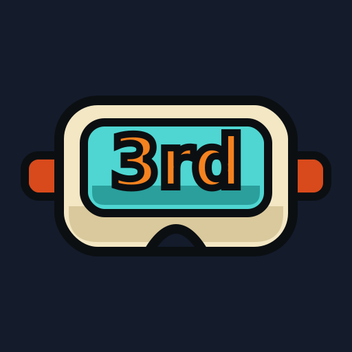

# 3rdVive

**3rdVive** is an add-on for the popular Vivecraft mod that unlocks third person, so you can play Minecraft VR in third person.

## How to use it

To switch to third person, press **F5** on your PC or use the **Toggle Perspective** button in the Vivecraft radial menu. To add that button to your radial menu, go to **Menu → Options → VR Settings → Radial Menu Config**.

## Config options

Settings are in `config/thirdvive.json`.

- **HUD position:** HUDs show up in front of you instead of in front of your player model by default. To turn this off, set `"hudOnCamera": false`.
- **Room-scale movement:** By default, moving around your room moves your player model the same way it would in first person. To turn this off, set `"lockMovement": true`.

## License

CC0-1.0. Vivecraft is a separate mod under its own license.
